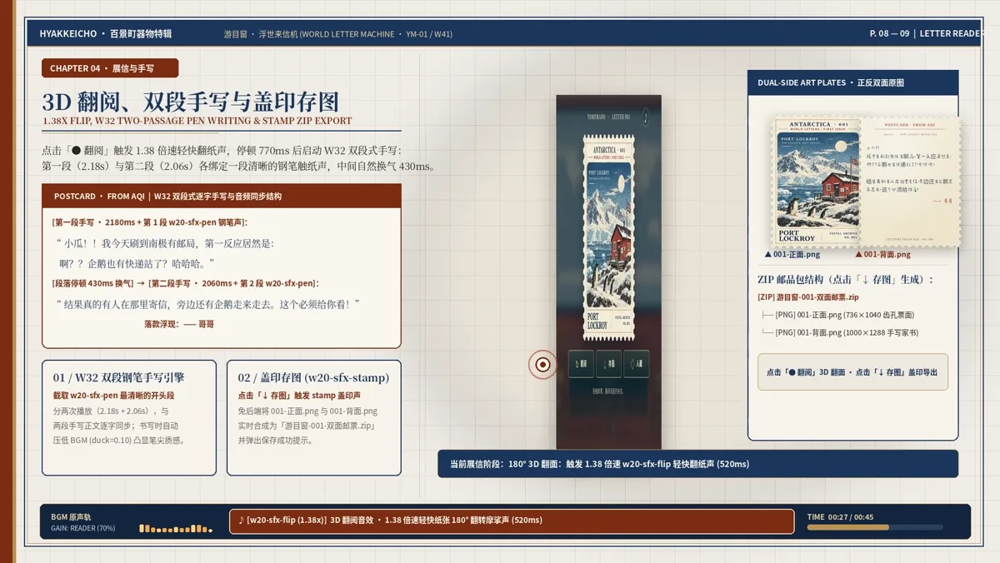

# 游目窗 · 浮世来信机

一台可自己部署的世界来信机：地图选点、黄铜按钮出票、取出邮票、翻面读信、保存正反面，再亲手收入藏信册。

**[直接体验公开机器](https://jianjidanbenren-eng.github.io/yomemado/template/)** · [45 秒真实项目演示与手记](https://jianjidanbenren-eng.github.io/yomemado/) · [制票 Skill](skills/yomemado-stamp-maker/SKILL.md) · [三份完整提示词](skills/yomemado-stamp-maker/references/prompts.md)

[](https://jianjidanbenren-eng.github.io/yomemado/#showcase)

公开模板沿用原项目的机器外壳与交互，接入三枚历史 Skill 测试样例：西藏拉萨布达拉宫、西藏山南普莫雍错、苏州留园。样例与私人信箱独立，来源和未核实项见 [provenance.json](skills/yomemado-stamp-maker/examples/provenance.json)。原视频是 45 秒静音剪辑，展示原作品的声音设计过程，但不是音效试听。

## 一键部署自己的机器

[](https://vercel.com/new/clone?repository-url=https%3A%2F%2Fgithub.com%2Fjianjidanbenren-eng%2Fyomemado&root-directory=template&project-name=my-yomemado&repository-name=my-yomemado)

[](https://app.netlify.com/start/deploy?repository=https://github.com/jianjidanbenren-eng/yomemado)

- Vercel：Root Directory 为 `template`，静态网页无需 Build Command 或环境变量。
- Netlify：仓库根目录的 `netlify.toml` 已设置 `base = "template"`、`publish = "."`。
- GitHub Pages：项目手记在根目录，公开机器在 `/template/`。

部署模板本身是纯静态 HTML/CSS/JS，无后端、API 密钥或 npm 依赖。制票脚本是独立的 Python/Pillow 工作流。

| 想改什么 | 修改位置 |
|---|---|
| 站名、界面收信人、字体与音乐地址 | `template/config.js` |
| 邮票正反面、来信文字数据、完整地点与点位 | `template/letters.js`、`template/assets/stamps/` |
| 机器外壳、颜色、纹理与布局 | `template/custom.css`；保留交互元素 ID |
| 制作自己的新邮票 | `skills/yomemado-stamp-maker/` |
| 部署和替换方法 | [模板使用说明](template/USAGE.md) |

修改网页字体或收信人不会重绘已有 PNG 内的文字；邮票内容需要用脚本重新导出，再替换正反面文件。

## 可复用的制票 Skill

[SKILL.md](skills/yomemado-stamp-maker/SKILL.md) 包括照片转绘、自主采风两种入口，引用 [规则](skills/yomemado-stamp-maker/references/rules.md)、[完整提示词](skills/yomemado-stamp-maker/references/prompts.md)、共享母版和可运行脚本。

流程：照片/核实资料 → 624×723 无字画芯 → 固定文字与外框套版 → 正反面 736×1040 RGBA PNG → 透明齿孔与文字校验。

```bash
python -m pip install -r skills/yomemado-stamp-maker/requirements.txt
python skills/yomemado-stamp-maker/scripts/render_stamp.py --art skills/yomemado-stamp-maker/examples/001-art.png --data skills/yomemado-stamp-maker/examples/001.json --font /path/to/local-songti-font --out output
python skills/yomemado-stamp-maker/scripts/check_stamp.py output/001-front.png output/001-back.png
```

中文短笺需要本地宋体/CJK 字体；按 [Skill 说明](skills/yomemado-stamp-maker/SKILL.md) 传入路径，字体文件不会上传。已有画芯套版与“AI 根据新照片生成画芯”是不同环节；三个历史样例不冒充新一轮全自动生图验收。原六场景规范中的另外三个场景尚未补齐可追溯成品。

## 收信和藏信规则

地图显示当前来信。新信加入后，之前的有效旧信自动进入藏信册并显示 READ / 已读；最新一封等待使用者点入藏。藏信按编号倒序排列，下载使用网页中同一对 PNG。

收藏、最新来信的阅读状态保存在本浏览器，跨设备不自动同步。自动采风、AI 制票、定时投递和跨设备个人账户同步属于后续可接的后端能力，模板不会连接作者的私人服务。

## 字体、音乐与来源

- 默认调用系统宋体或宋体类衬线字型，可以按喜好更换；不分发系统字体文件。示例 PNG 背面以 Noto Serif CJK（思源宋体类）渲染。
- 演示视频中的手写字体为白河的[星光小熊猫体幼儿风 Beta 2.1](https://github.com/cyberinkflow/StarPandaKidsFonts)；公开包不含该字体文件。
- 原项目配乐参考 **AKMU（乐童音乐家）《Farewell》 / SAILING**：[官方收听](https://music.apple.com/us/song/farewell/1480802556)。保留播放器和更换入口，公开包不附原录音。
- 现有机器与示例的来源、参考项目和边界见 [第三方说明](THIRD_PARTY_NOTICES.md) 与 [公开边界](docs/公开边界.md)。原创代码与文档采用 [MIT License](LICENSE)，不替第三方字体、录音或其他素材授予许可。

## 开发检查

```bash
python -m pip install -r requirements.txt
python -m unittest discover -s tests -v
node --test tests/archive-state.test.cjs
```

本地体验：`cd template` 后运行 `python -m http.server 8000`，打开 http://localhost:8000。请用本地服务器检查 ZIP 下载，避免直接双击 HTML 的文件读取限制。
