# 游目窗制票

一次请求完成一枚可打开、可下载的完整邮票：**默认最终交付正面 PNG 和背面 PNG**，另附结构化数据、来源与校验结果。用户不需要再逐步指挥画芯、套版和导出。先读 [规则](references/rules.md) 和 [完整执行提示词](references/prompts.md)。

“无字画芯 → 固定套版”是内部制作方法：由图像工具画插画，随后自行调用程序写字、套版、导出并检查。图像工具返回画芯后必须继续，不询问是否还要做成邮票，也不把子任务中的“只输出插画”当成整个 Skill 的结束指令。只有用户明确仅要画芯、提示词或资料时，才停在对应阶段。

本 Skill 在 cakeni 的 Ukiyoe Picture Skill、Yan Liu 的 Mono Color Skill、FANTASY／梵想美学的 Photo Revival 等公开方法上学习、改写，再形成游目窗的制票约束。首次使用或再次分发时读 [来源与改写](references/sources.md)，保留作者、原仓库链接和随包许可。完整提示词另含总执行、事实短笺与成品复核入口；不要只执行画芯提示词就把整条流程标为完成。

## 默认版式与按需定制

将随包的竖版、736×1040 成品、624×723 画芯、两行地名和齿孔视为作者这一版选定的样式。用户可以另选邮票形式、横竖比例、排版、尺寸、字体、颜色和边缘形状。

- 未提出改版时，直接沿用随包母版，不反复询问。下文和参考文件中的固定字号、坐标、两行标题与尺寸均约束这套默认母版及其系列续作。
- 用户明确要求新样式时，先按需求确定新母版的成品尺寸、画芯区域、文字层级、外沿与正反面关系，再在用户自己的项目中实施；沿用现有目录即可，不覆盖本包默认母版与六套示例。
- 当前 `render_stamp.py` 和 `check_stamp.py` 专用于随包尺寸。新比例或排版需要同步适配母版、渲染坐标、数据字段、画芯提示词和检查目标；没有任意尺寸的一键参数。具体文件与步骤见[规则页的定制方法](references/rules.md)。
- 按新规范实际制作并检查一枚 TEST，再延续同一系列。定制后仍须核实事实、保留源文件、不拉伸主体，并交付用户要求的完整成品。

## 选择入口

- 用户提供照片：采用 `mode=photo`。以实际照片确定主体、构图与物体关系。记录来源；不要把未附带的照片当成已经读过。
- 用户要求从真实地点自主创作：采用 `mode=autonomous`。先查可靠来源，保存地点全名、事实、来源 URL 与不确定项；未知坐标保留 null。
- 用户只要求从准备好的画芯套版：直接使用已有画芯，并明确标注这一步没有验证 AI 生图或原始照片转换。

内部调用图像模型时，只让它生成 624:723 的无字插画，再自动进入套版。使用当前环境提供的图像能力；没有图像工具或生成失败时明确说明完整邮票尚未完成，不拿旧样例冒充新作品。已有画芯入口则直接继续套版。

## 输入与制作

1. 实际读取照片或核实指定地点，整理主题、来源、必要事实和两段短笺；未知坐标保留 null，不要求用户代填可查资料。照片模式保留原图原始字节，命名为 `<id>-source.png`（其他格式保留原扩展名），在 JSON 中记录来源、尺寸和 SHA-256；不覆盖原图，不将画芯当原图。公开示例中的原图需有用户的公开指示。
2. 复制 `examples/001.json` 的结构，填写 id、mode、sourcePhoto 或 facts.citations、全称、日期、短笺、署名和 stamp 字段。测试用 TEST；示例编号与任何作者私人信箱无关。使用本环境的图像工具完成无字插画，再准备为 624×723；必要时延展背景，不拉伸主体。
3. 为底部地名提供恰好两个非空字符串。保留固定字级与基线；溢出时缩短准确文案，无法合理缩短时标为 NEEDS_TITLE_REVIEW。
4. 在本 Skill 目录运行：

```bash
python -m pip install -r requirements.txt
python scripts/render_stamp.py --art examples/001-art.png --data examples/001.json --font /path/to/local-songti-font --out output
python scripts/check_stamp.py output/001-front.png output/001-back.png
```

路径以实际输入替换。`--font` 指向本机有权使用的宋体/CJK 字体；Windows/macOS/部分 Linux 会自动检测常见宋体路径。英文短笺可省略该选项。没有中文字体时明确报错，不默默输出方框。可选 `--print-font` 控制正面英文衬线字体，替换后重新检查溢出。

5. 检查输出：默认版正反面均为 736×1040 RGBA、同一 Alpha，四角与齿孔外部透明；在白底、黑底和棋盘格上检查无黑边。明确定制的成品按本次新规范检查尺寸、外沿与正反面关系。
6. 肉眼核对画芯、两行标题、编号、地名与短笺；脚本不替代视觉和事实检查。

## 样例与输出边界

随包包含六套照片示例，每套在 `examples/` 中同时保留**原图、画芯、JSON 数据、完整正面 PNG 和完整背面 PNG**。原图逐字节保留，完整成品均为 736×1040 RGBA。001–003 沿用已确认的历史画芯与成品；004–006 在2026-10-28使用用户重新提供的原图完成新转绘与套版。

| 示例 | 原图 | 完整正面 | 完整背面 | 制作文件 |
| --- | --- | --- | --- | --- |
| 001 · 布达拉宫 |  | 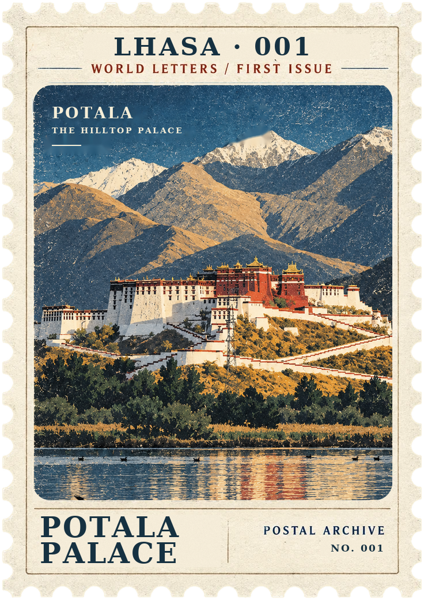 | 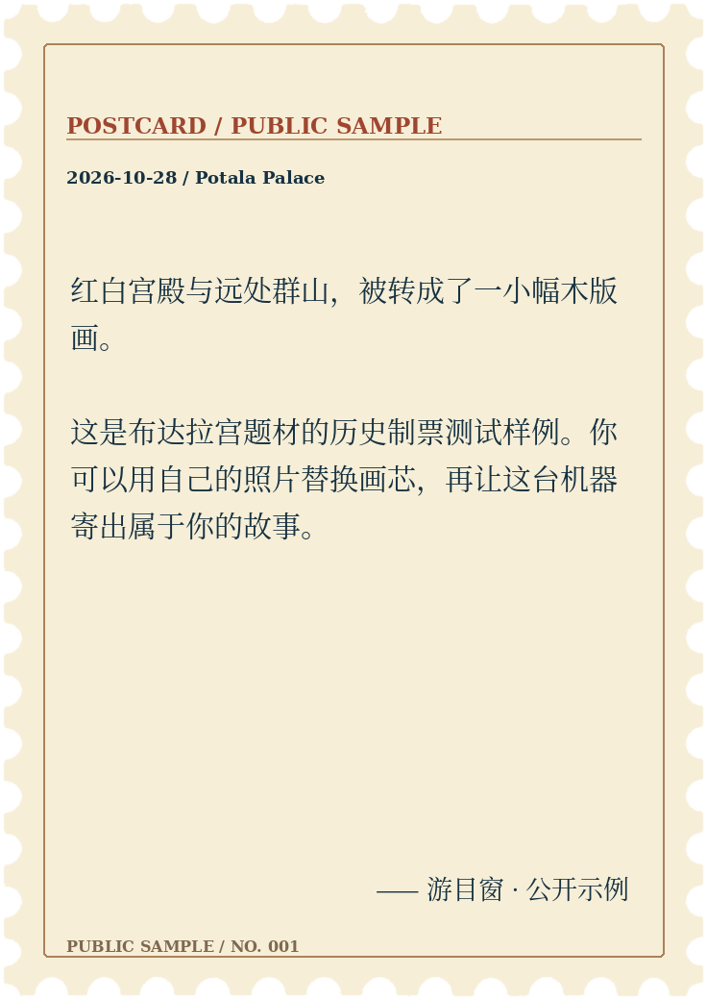 | [画芯](examples/001-art.png) · [数据](examples/001.json) |
| 002 · 普莫雍错 |  | 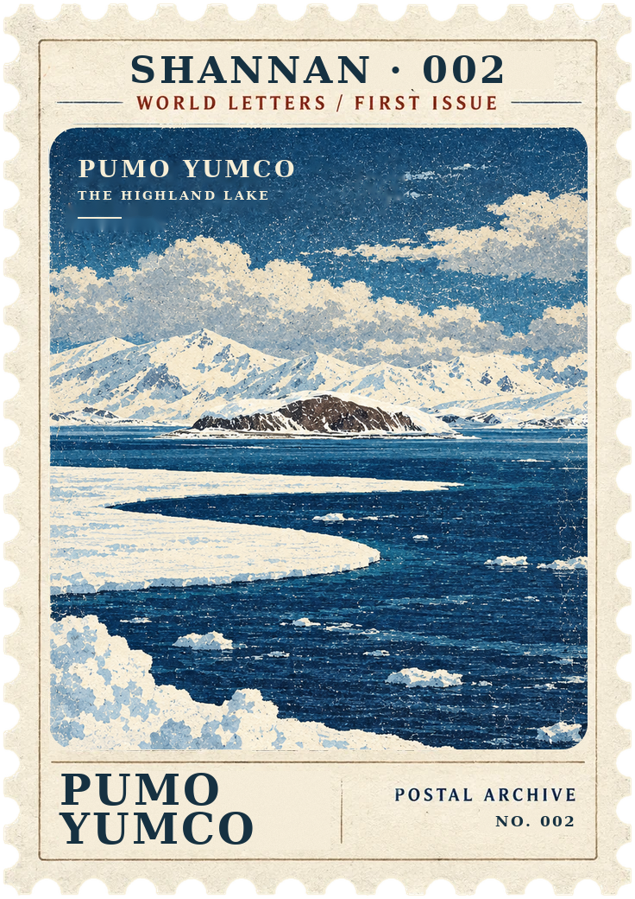 | 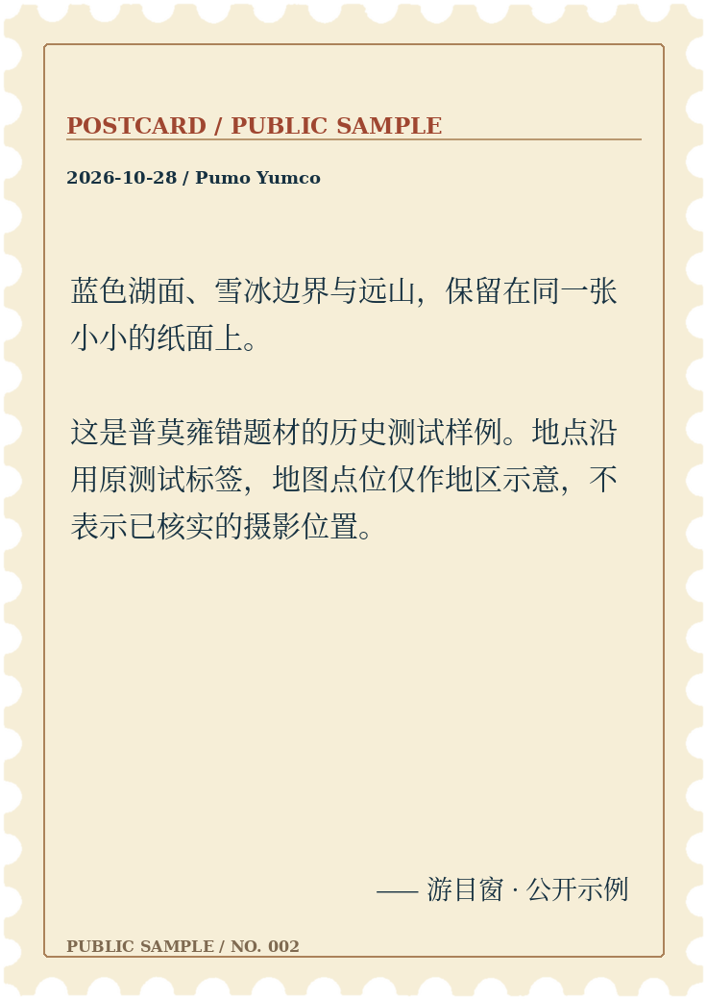 | [画芯](examples/002-art.png) · [数据](examples/002.json) |
| 003 · 苏州留园 |  | 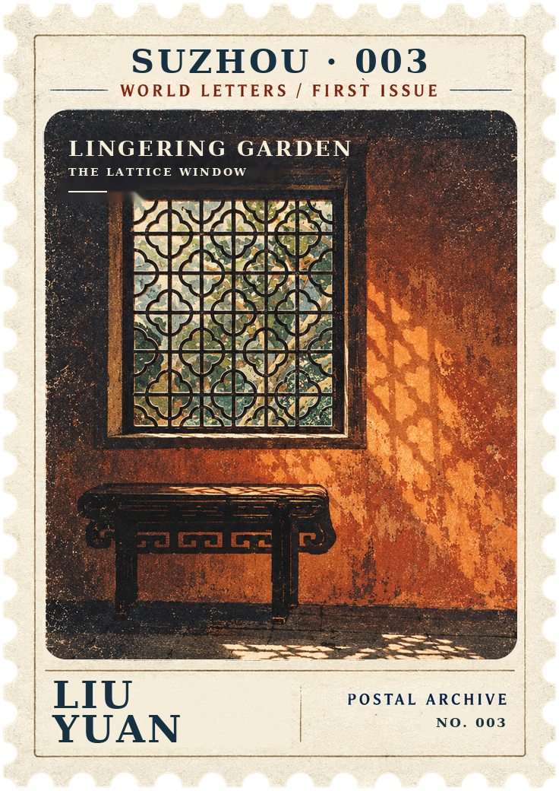 | 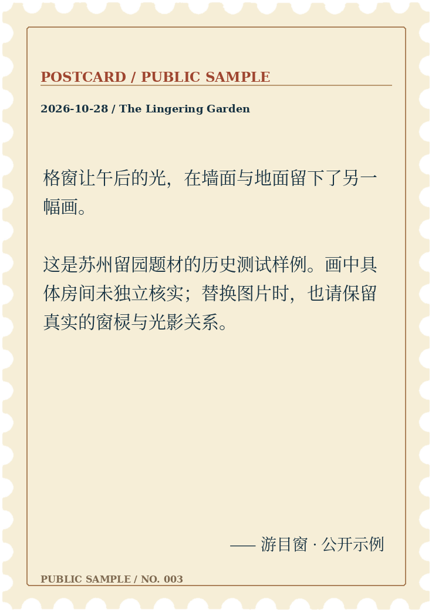 | [画芯](examples/003-art.png) · [数据](examples/003.json) |
| 004 · 羊卓雍措（羊湖） |  |  | 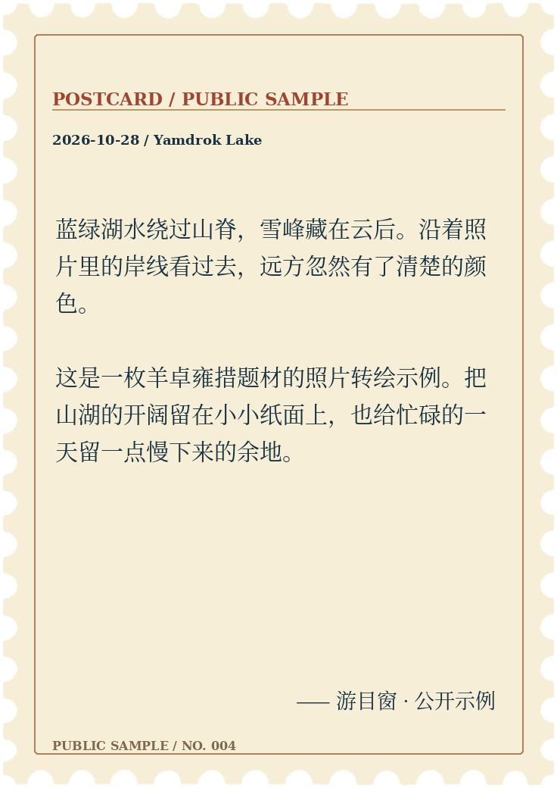 | [画芯](examples/004-art.png) · [数据](examples/004.json) |
| 005 · 里斯本・阿尔法玛｜窗与海 |  | 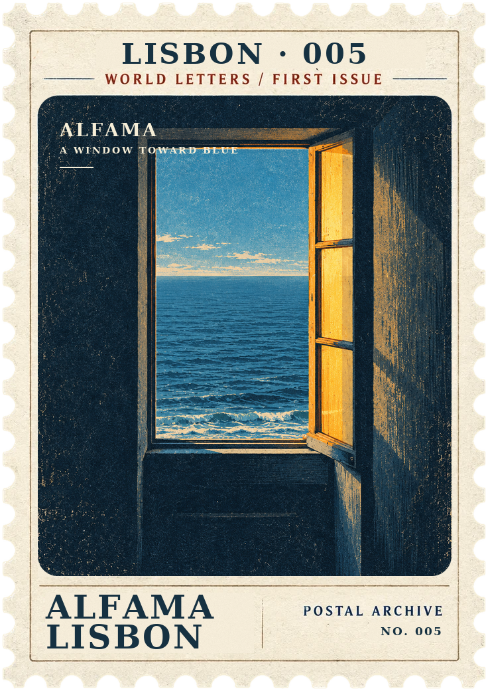 | 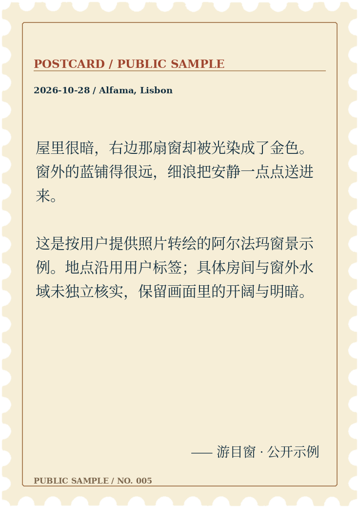 | [画芯](examples/005-art.png) · [数据](examples/005.json) |
| 006 · 莫干山民宿｜山景长窗 |  | 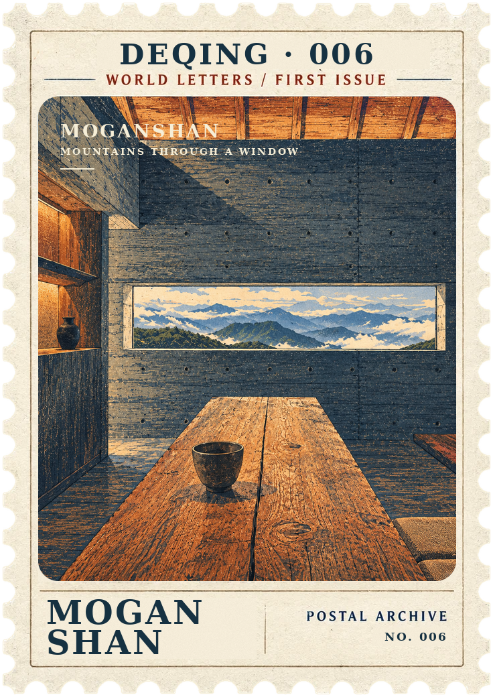 | 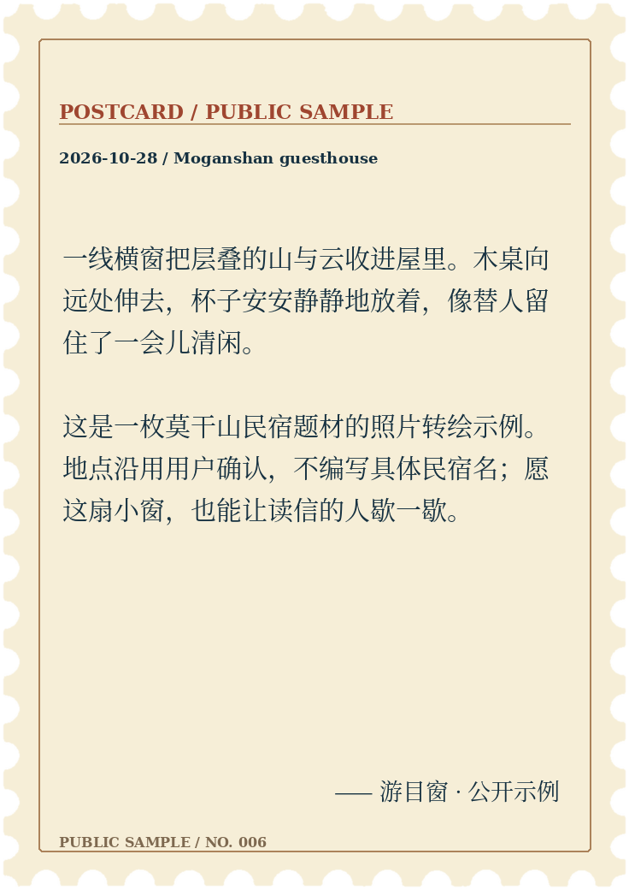 | [画芯](examples/006-art.png) · [数据](examples/006.json) |

[来源记录](examples/provenance.json) 对应六套文件、原图校验和及实际检查结果。原图由用户提供，不冒称用户摄影，也不将代码 MIT 许可自动套用于第三方照片。六套 Skill 示例与网页信箱分别维护：公开机器仍加载原有 001–003 三封，004–006 仅为制票示例，编号与私人信箱无关。

`assets/master.png` 是清除私人图心和动态字段后的共享框纸/Alpha 母版；`assets/style-reference.png` 是公开画芯风格参考。程序接受已准备好的画芯，不调用模型、查询网络或投递网页。

## 最终交付与完成条件

- 默认只向用户展示最终完整邮票；画芯、生图草稿、套版中间图和过程预览留在内部，除非用户明确要求查看。进度只用简短文字说明。
- 先展示并提供可打开的 `<id>-front.png` 和 `<id>-back.png`；默认版为完整的 736×1040 RGBA 成品，文字、编号、边框和齿孔齐全；定制版按本次明确的新形式与规格交付。
- 同时保留完整 JSON、来源、原图（照片模式）、画芯和实际校验结果；画芯是制作源文件，不替代邮票成品。按当前环境的保存规范保存产物，回复中给出实际可用文件链接。
- 完成条件是两面实际导出并通过程序与视觉检查；只有画芯、提示词、资料或预览海报时，不报告“邮票已生成”。
- 将“新画芯生成”“双面成品导出”“网页发布”分别报告。网页接入是独立可选步骤，不是生成邮票的前置条件，也不因制票请求自动发布。

网页机壳、字体和音乐的修改见仓库使用说明。六个场景均已包含原图与完整双面成品；地名由用户确认，具体拍摄点、莫干山民宿名与精确坐标仍不杜撰。羊卓雍措蓝绿湖景与普莫雍错冰雪湖景分别记录。
